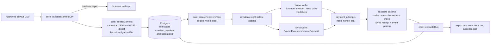

# Architecture

## Data flow

## Packages

`packages/core` holds every rule that decides whether money moved, and it has no I/O. The API, the SDK and the tests all call the same functions, so behaviour can't drift between them.

- `validateManifestCsv` parses CSV strictly (RFC 4180, ragged rows and stray quotes are errors). It checks per-asset decimals without floating point, canonicalises addresses (EIP-55, SS58 re-encoded to prefix 42), and flags duplicate-looking rows that still need acknowledgement.
- `freezeManifest` sorts obligations by `line_id`, serialises canonical JSON (sorted keys, safe integers only, amounts as strings) and hashes it with SHA-256. Re-ordering rows doesn't change the digest; changing any amount does.
- `deriveObligationId` is `keccak256(abi.encode("payout-replay/obligation@1", chainIdentity, payerKey, runId, uint32 version, lineId))`. Native payers are keyed by public key, so the SS58 prefix can't change the ID.
- `reconcileObligation` applies the matching rules in a fixed order: finalised exact proof, then mismatched proof (`incorrect`), then manual resolution, then unknown (`needs_review`), then in flight, then all-failed (`failed_verified`), then unattempted. It deduplicates by transaction hash, so an app attempt and a chain scan of the same transaction count once.
- `createRecoveryPlan` and `revalidateRecoveryPlan` produce an expiring plan with a SHA-256 fingerprint. Revalidation checks only the lines about to be signed, against fresh chain state.

## Adapters

Both implement `ChainAdapter` and return `AttemptOutcome`: `pending`, `included`, `finalized_success`, `finalized_failure` or `unknown`. An adapter must return `unknown` whenever it can't prove an outcome, and nothing above it upgrades certainty.

Native (`packages/adapters-native`):

- Looks up the extrinsic by hash in the block the wallet reported. If that fails, it scans every block of the extrinsic's mortal era.
- Checks the signer is the payout wallet, reads `System.Events` at that block and keeps only records whose phase is `ApplyExtrinsic(index)`.
- `ExtrinsicFailed` becomes a conclusive failure, decoded to `pallet.Error`.
- `ExtrinsicSuccess` with `Balances.Transfer` events becomes a success. A successful self-transfer emits no Transfer event and so never settles an obligation. That case is pinned by a live test against V3 block 106425.
- Not found after the whole era is finalised, or with the nonce consumed at the finalised head, becomes a conclusive failure. Otherwise the attempt stays pending.

EVM (`packages/adapters-evm`):

- A receipt is final when its block number is at or below `finalized` and the canonical hash at that height matches.
- A reverted receipt becomes a conclusive failure.
- A success needs `PaymentExecuted` from our executor plus the matching ERC-20 `Transfer`. An executor event without its Transfer is reported as `unknown`.
- A missing hash with an unused nonce stays `unknown`, because the signed transaction could still be broadcast.
- A missing hash with a consumed nonce is decided by `wasExecuted(payer, obligationId)` at the finalised block. If the obligation wasn't executed, the attempt is a conclusive failure. If it was, `getLogs` must find the replacement settlement, or the outcome stays `unknown`.

## API and persistence

Hono on PostgreSQL with Drizzle. Migrations live in [infra/migrations](../infra/migrations). `0001_immutability_triggers.sql` makes frozen manifests, obligation terms and transaction identity write-once in the database itself, and makes attempts, observations and audit events append-only.

The concurrency rules:

- A payment attempt is created as `prepared` before the wallet prompt opens. It is inserted inside a transaction that holds `SELECT … FOR UPDATE` on the obligation row and refuses if any attempt for that obligation is unresolved.
- Every write requires an `Idempotency-Key`. A repeated key with the same body replays the stored response, and with a different body it returns 409.
- A version with any broadcast attempt can never be replaced, because new obligation IDs would let the same line be paid twice.

The worker re-observes non-final attempts every 15 seconds. It also scans the executor for settlements no attempt recorded, expires plans and delivers HMAC-signed webhooks. It reads the chain and never signs, so a duplicated tick can't move funds.

## Web app

Next.js App Router. `/api/v1/*` and `/health/*` are rewritten to the API so the session cookie stays first-party. Cookie-authenticated writes must come from the web origin.

The run workspace follows the job in order: import, review and approve, execute, settlement, recover, export. Data is polled while anything is in flight; there is no fake progress.

Native signing builds the call in the browser and refuses to continue unless it is byte-identical to the server-prepared call on the same genesis and spec version. It signs with a 64-block mortal era and records hash, nonce and era before broadcasting.
